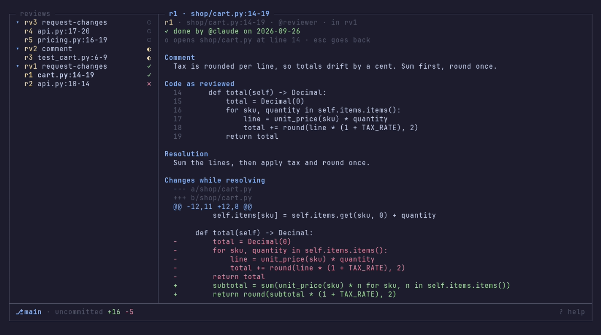

# rvw

Code review for humans/AI.


`rvw` is a local review queue. You leave comments on line ranges of files,
from an editor, a shell or an agent. The agent working on that code pulls
them, acts on them, and records what became of each one.

## Why

Code review usually happens after the code is pushed, on a hosted platform,
in a pull request. When an AI agent writes the code, feedback is needed
earlier and closer to the work: while the agent is still running, on files
that are not committed, sometimes from another agent. Pasting notes into a
chat loses where they point, what the code looked like and whether anyone
acted on them.

`rvw` keeps that conversation local and structured:

- **Anchored.** Each comment names a file, a line range and the code as it
  stood when it was written.
- **Handed over once.** A pull takes comments out of the queue, so no agent
  works the same note twice.
- **Accounted for.** Each comment ends in a recorded decision: done, or
  rejected with a reason. Done comments keep the diff they produced. A second
  reviewer can accept that decision or reopen it as a follow-up.
- **Scoped.** A queue belongs to a workspace: a git worktree. rvw needs git; a
  directory outside a repository has no queue. Lanes divide a queue when
  several branches share one working tree.

## Install

On Linux or macOS (amd64 or arm64):

```sh
curl -fsSL https://raw.githubusercontent.com/gustavofsantos/rvw/main/install.sh | sh
rvw --version
```

The script downloads the latest release for your OS and CPU, checks it
against the release's checksums and puts `rvw` in `~/.local/bin`. Run it again
to upgrade. Pick a release or another directory with arguments after `sh -s --`:

```sh
curl -fsSL https://raw.githubusercontent.com/gustavofsantos/rvw/main/install.sh | sh -s -- --version v1.1.0 --dir /usr/local/bin
```

Archives for Linux and macOS are on the
[releases page](https://github.com/gustavofsantos/rvw/releases). Windows is not
supported. With Rust installed you can also build it yourself:

```sh
cargo install --git https://github.com/gustavofsantos/rvw rvw-cli
```

Or, from a checkout, `make install`: an optimized build, installed with cargo
to `~/.cargo/bin/rvw` (or `bin/rvw` under `PREFIX=/some/dir`) and stamped with
`git describe`. Run it again to upgrade; `make uninstall` removes it.

The queue's store moves to schema 2 the first time this version opens it. The
v1 file is copied to `<db>.v1.bak` first, once. Older binaries refuse a schema 2
database, so update `rvw`, the desktop app and the MCP server together:

```sh
ls ~/.local/share/rvw          # rvw.db, and rvw.db.v1.bak after the upgrade
```

On Linux the release archive and `install.sh` also install the desktop app
(`rvw-gui`) with its icon and an application-menu entry under
`~/.local/share`; from a checkout, `make install-gui` does the same. On macOS,
`make install-gui` builds it into `~/Applications/rvw.app` (`APPDIR=/some/dir`
to change that); the Xcode Command Line Tools are enough. Launched from the
menu or Finder, it opens the workspace with the most work waiting.

The desktop app has a terminal dock (Unix only). `⌘J` shows or hides it, `⌘T`
opens a new terminal (a shell, or a typed command run with `/bin/sh -c`),
`⌘W` closes the tab, `⌘1`..`⌘9` switch tabs. On Linux the chords are
`Ctrl+Shift+J`, `T`, `W` and `1`..`9`, so the shell keeps plain Ctrl keys.
Drag selects (double click a word, triple click a line, Alt-drag a block) and
`⌘C` (`Ctrl+Shift+C`) copies; on Linux a selection is also the primary
selection and middle click pastes it. The wheel and `Shift+PageUp/PageDown`
scroll the scrollback, and `⌘F` (`Ctrl+Shift+F`) finds in it: Enter and
Shift+Enter step, Esc closes. A program that asks for the mouse (vim, less,
htop) gets it; hold Shift to select instead. `⌘`-click (`Ctrl`-click) opens an
http, https or file link under the pointer. Quitting with terminals running
asks first.

`⌘B` collapses or shows the left panel and `⇧⌘B` the right one (`Ctrl+B` and
`Ctrl+Shift+B` on Linux; with a terminal focused only the Ctrl+Shift form acts).
The buttons at the top bar's two ends do the same, and the centre takes the
room. Drag a panel's inner edge (or the dock's top edge) to resize it, and
double-click the edge to reset it. Collapsed panels and sizes last until the
window closes.

## Examples


Leave comments where you read the code:

```sh
rvw add --file src/api.py --lines 40-58 --comment "extract this branch"
rvw add --file src/api.py --lines 12 --comment "typo" --lane refactor-auth
rvw add --file src/api.py --lines 40-58 --points-at src/old.py:12-20 --comment "moved from here"
```

`--points-at FILE:N` or `FILE:N-M` names another range the note refers to, such
as where moved code came from. The agent reads it along with the comment.

Change your mind before the handoff:

```sh
rvw edit r2 --comment "typo in the docstring"
rvw remove r2                  # only pending comments outside a submitted review
```

Or read the code and comment in a terminal UI, without an editor plugin:

```sh
rvw tui
```

Group them into one review with a verdict:

```sh
rvw submit --id r1 --id r2 --decision request-changes --summary "Fix both before merging"
```

Hand the review to the agent, as markdown or JSON:

```sh
rvw pull
rvw pull --lane refactor-auth --format json
rvw pull --peek                # read without dequeuing
```

Close the loop:

```sh
rvw resolve r1 --author claude --note "extracted into parse_header(), test added"
rvw reject r2 --author claude --note "intentional: the caller validates"
rvw show r1                    # the comment, its resolution and the diff
rvw show rv1                   # the whole review sheet
```

A decision made after a handoff waits for a second reviewer. Accept it, which
makes it final, or reopen it: the note becomes a pending follow-up on the same
lane, file and range (`--lines` moves it), and the next pull hands it over.
Nobody can judge their own decision.

```sh
rvw accept r1 --note "checked the new test" --author alice
rvw reopen r2 --note "the rename missed api.py" --author alice
```

Keep an eye on it:

```sh
rvw list --status open         # raised, not yet decided
rvw list --reviews             # submitted reviews and their state
rvw count                      # pending handoffs, for a statusline
rvw workspaces                 # every workspace with something pending
rvw gate                       # open or unjudged comments, before a commit or push
```

`rvw gate` only reports; it does not stop a commit. When you go ahead anyway,
record it, with the reason:

```sh
rvw gate override --action commit --reason "reviewer is out until Monday"
```

The record keeps the reason and the ids that were open or unjudged at that
moment. It is refused when the gate is clear, and nothing is deleted.

Or skip the shell: `rvw mcp serve` exposes the same operations as MCP tools
(see [MCP server](#mcp-server)).

`rvw --help` lists every command and flag.

## Terminal UI

`rvw tui` is code review in the terminal, on the files as they are on disk.
The left pane is the workspace's file tree, without the files git ignores,
with `💬N` next to files that have open comments. The right pane is the
current file, syntax-highlighted, with a rail in the gutter on every line
under an open comment. The gutter's left edge also marks what changed, staged
or not: a green `▎` for an added line, a blue `▎` for a changed one, and a red
`▁` under the spot where lines were deleted (`▔` over the first line when the
top was). An untracked file shows as all added. The bottom bar shows the
comments on the cursor line; elsewhere it shows the branch and the
uncommitted changes against `HEAD`, as `+added -deleted` counts of lines
(every line of an untracked text file counts as added), or `clean`.

`t` cycles the left pane through every file, only the changed ones, and the
reviews. The changed files come with their git status: `M` modified, `A` added, `D` deleted, `?`
untracked. Opening a file from that list puts the cursor on its first
change. `b` chooses what the files on disk are compared with, for that
list and for the gutter marks alike:

- **uncommitted**, the default: against `HEAD`.
- **default branch**: against where the branch left `main` or `master`
  (`origin/HEAD` when set), so the list is the branch's own work, committed
  or not, like a pull request.
- **previous commit**: against `HEAD~1`, so the last commit plus anything
  uncommitted.

The reviews pane lists every submitted review, newest first, with its
comments under it, then the comments that belong to no review. Each is marked
with where it stands: `○` pending, `◐` pulled, `✓` done (a review once every
comment is decided), `✗` rejected. Opening one shows a page in the right pane
of what was asked and how it was addressed: a review's summary and each
comment's outcome; a comment's note, the code as reviewed, the resolution
note and, for a done comment, the diff of the file while it was resolved.
`o` opens the file at the comment, `esc` goes back to the file you had open.



- `<leader>p` opens a file by fuzzy name; `<leader>l` lists the open
  comments. The leader is space; `--leader` makes it another key, such as `,`.
- `V` selects lines, `c` comments on the line or the selection, `e` edits the
  pending comment on the line, `s` submits your pending comments as a review.
- `]c` and `[c` jump between comments, `]h` and `[h` between git changes,
  going round from the last change to the first and back;
  `r` reloads the file, the changed files, their git changes and the queue.
  Nothing is watched, so comments added elsewhere show up on the next reload.
- `?` lists every key.
- The mouse works too: click a file in the tree to open it, click a directory
  to expand or collapse it, click a line to move there, drag across lines to
  select them, and scroll either pane with the wheel. Most terminals still
  select text for copying with Shift held (Option in iTerm2).

You write comments in your editor: `--editor`, else `$VISUAL`, else `$EDITOR`,
else `vi`. Lines below the `>8` scissors line are context and are dropped;
save an empty note to cancel. `--lane` and `--author` stamp what you add and
submit. The gutter shows the open comments of every lane.

```sh
rvw tui --lane refactor-auth --editor "code --wait"
```

## Claude Code

[Install the binary](#install), connect the MCP server, then install the
plugin. The plugin adds an `rvw` skill that teaches Claude to pull the queue,
act on each comment and resolve or reject it, judge decisions, and check the
gate before a commit, through the rvw MCP tools.

```
/plugin marketplace add gustavofsantos/rvw
/plugin install rvw@rvw
```

Connect the MCP server as described in [MCP server](#mcp-server) below
(`rvw mcp config` prints the command). Then ask Claude to "address the review comments", or run `/rvw:rvw`.

### MCP server

Agents that prefer tool calls to shell commands can use rvw as an MCP server.
Every operation is a tool: `add`, `submit`, `list`, `list_reviews`, `count`,
`pull`, `show_comment`, `show_review`, `resolve`, `edit`, `remove`, `judge`,
`gate`, `override_gate` and `workspaces`, with typed JSON inputs and structured
JSON results.

A verdict given through the server is recorded as `agent`, whatever `author`
says: rvw records the surface a verdict came through, not an identity. The
rvw skill leaves `override_gate` out of its tools, so an agent's gate override
always asks the user first.

`rvw mcp config` prints the command that registers the server with Claude Code,
and the equivalent `.mcp.json` entry:

```sh
rvw mcp config --author claude
# claude mcp add --scope user rvw -- rvw mcp serve --author claude
```

By default Claude Code starts `rvw mcp serve` itself and talks to it over
stdio. To keep one server running instead, serve streamable HTTP on a local
address and point Claude Code at it. The server has no authentication, so
`--http` accepts only a loopback address (`127.0.0.1`, `::1` or `localhost`):

```sh
rvw mcp serve --http 127.0.0.1:7777
rvw mcp config --http 127.0.0.1:7777
# claude mcp add --transport http --scope user rvw http://127.0.0.1:7777/mcp
```

Each tool call names its `workspace`, so one server serves every project. A
call that leaves it empty uses the git worktree the server started in; outside
git the server refuses to start. `--lane` and `--author` on
`rvw mcp serve` fill calls that leave them out.

## Use cases

- **Human → agent.** Read an agent's changes in your editor and leave comments
  on the lines as you go. Tell the agent to pull the review. It works through
  the comments and records a decision on each.
- **Agent → agent.** A reviewing agent adds comments and submits a review with
  `--author reviewer`. The coding agent pulls the review, fixes the code and
  resolves each comment. You read the outcome with `rvw show`.
- **Parallel branches.** With several branches in one working tree, give each
  agent its own `--lane`. A pinned pull never takes another lane's comments,
  and it reports when work is waiting in another lane.
- **Audit trail.** `rvw list --status done --format json` gives you every
  addressed comment with who resolved it and when. `rvw show` shows what
  changed.

## Credits

The GUI's icons are [Phosphor Icons](https://phosphoricons.com), MIT licensed;
the licence is `crates/rvw-gui/assets/icons/LICENSE-phosphor`.
